<!-- GitHub profile README — repo name must exactly match your username: arellaTV -->

  <picture>
    <source media="(prefers-color-scheme: dark)" srcset="./assets/header-dark.svg" />
    <source media="(prefers-color-scheme: light)" srcset="./assets/header-light.svg" />
    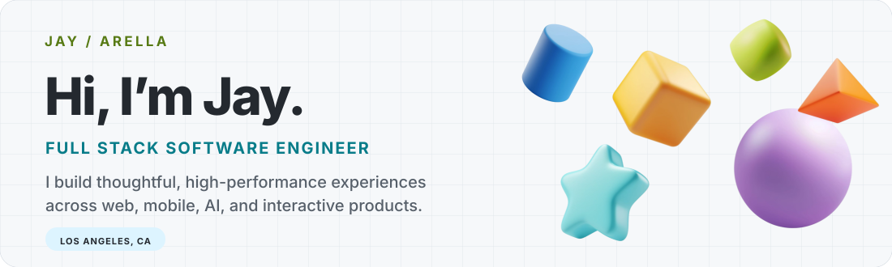
  </picture>

  [**Portfolio**](https://jayarella.dev) &nbsp;·&nbsp; [**LinkedIn**](https://www.linkedin.com/in/jay-arella/) &nbsp;·&nbsp; [**GitHub**](https://github.com/arellaTV) &nbsp;·&nbsp; [**Email**](mailto:jeremiah.arella@gmail.com)

  <picture>
    <source media="(prefers-color-scheme: dark)" srcset="./assets/about-dark.svg" />
    <source media="(prefers-color-scheme: light)" srcset="./assets/about-light.svg" />
    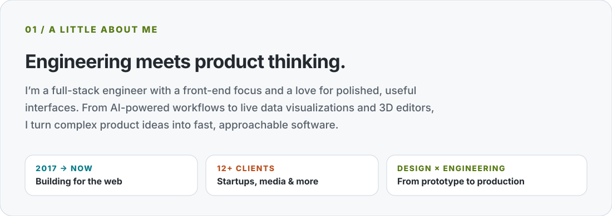
  </picture>

  <picture>
    <source media="(prefers-color-scheme: dark)" srcset="./assets/work-title-dark.svg" />
    <source media="(prefers-color-scheme: light)" srcset="./assets/work-title-light.svg" />
    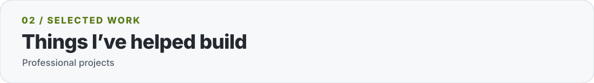
  </picture>

  <a href="https://psvtracker.com">
    <picture>
      <source media="(prefers-color-scheme: dark)" srcset="./assets/work-1-dark.svg" />
      <source media="(prefers-color-scheme: light)" srcset="./assets/work-1-light.svg" />
      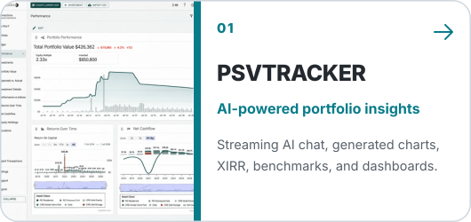
    </picture>
  </a>   <a href="https://trysalient.com">
    <picture>
      <source media="(prefers-color-scheme: dark)" srcset="./assets/work-2-dark.svg" />
      <source media="(prefers-color-scheme: light)" srcset="./assets/work-2-light.svg" />
      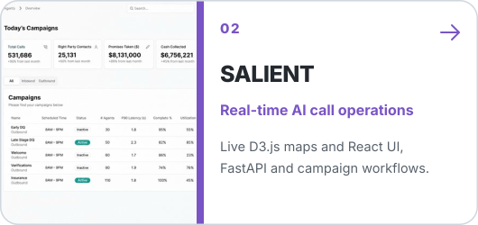
    </picture>
  </a>

  <a href="https://krikey.ai">
    <picture>
      <source media="(prefers-color-scheme: dark)" srcset="./assets/work-3-dark.svg" />
      <source media="(prefers-color-scheme: light)" srcset="./assets/work-3-light.svg" />
      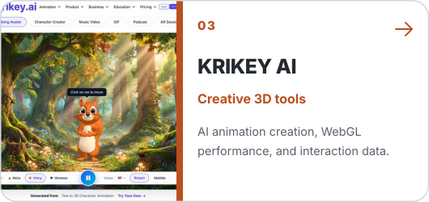
    </picture>
  </a>   <a href="https://realmhome.com">
    <picture>
      <source media="(prefers-color-scheme: dark)" srcset="./assets/work-4-dark.svg" />
      <source media="(prefers-color-scheme: light)" srcset="./assets/work-4-light.svg" />
      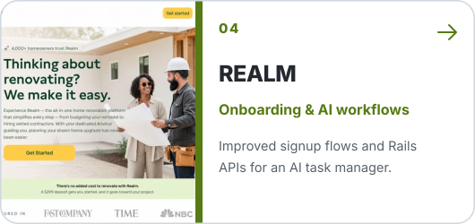
    </picture>
  </a>

  <a href="https://3w3m.com">
    <picture>
      <source media="(prefers-color-scheme: dark)" srcset="./assets/work-5-dark.svg" />
      <source media="(prefers-color-scheme: light)" srcset="./assets/work-5-light.svg" />
      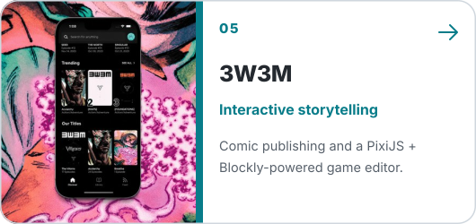
    </picture>
  </a>   <a href="https://laist.com">
    <picture>
      <source media="(prefers-color-scheme: dark)" srcset="./assets/work-6-dark.svg" />
      <source media="(prefers-color-scheme: light)" srcset="./assets/work-6-light.svg" />
      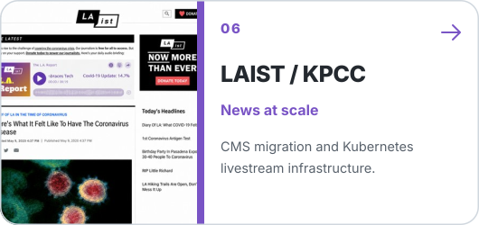
    </picture>
  </a>

  <picture>
    <source media="(prefers-color-scheme: dark)" srcset="./assets/stack-dark.svg" />
    <source media="(prefers-color-scheme: light)" srcset="./assets/stack-light.svg" />
    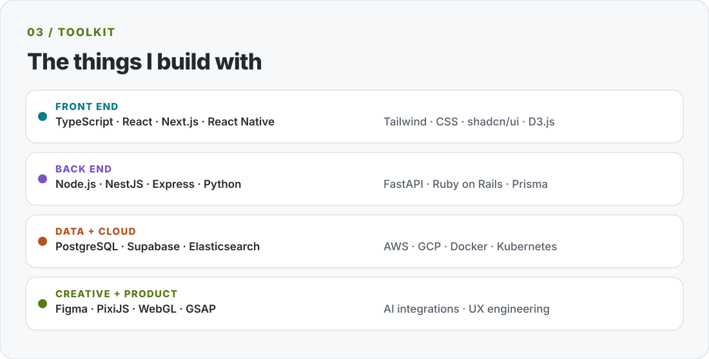
  </picture>

### 04 / From my GitHub

A few public repos that show my curiosity beyond client projects:

- 🎮 **[quizzler-3ds](https://github.com/arellaTV/quizzler-3ds)** — a quiz game for the Nintendo 3DS.
- 🐉 **[creature-dex](https://github.com/arellaTV/creature-dex)** — a Pokédex-inspired creature index built with Vue and Babylon.js.
- ✉️ **[strapi-plugin-invite-email](https://github.com/arellaTV/strapi-plugin-invite-email)** — invite admins to Strapi using templated magic-link email.
- 📊 **[aws-lambda-instagram-stats](https://github.com/arellaTV/aws-lambda-instagram-stats)** — fetch Instagram URL statistics with AWS Lambda.

  <a href="https://jayarella.dev/" title="Visit Jay Arella’s portfolio">
    <picture>
      <source media="(prefers-color-scheme: dark)" srcset="./assets/footer-dark.svg" />
      <source media="(prefers-color-scheme: light)" srcset="./assets/footer-light.svg" />
      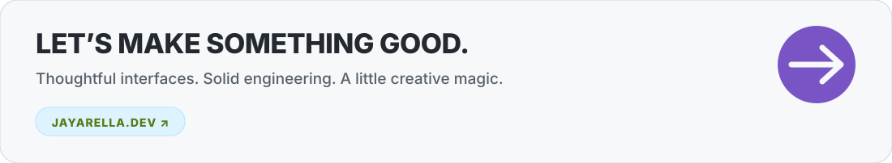
    </picture>
  </a>

